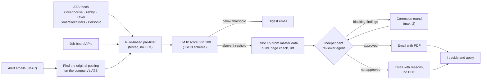

# CV Generator · Job Matching Pipeline

Two tools that share one source of truth for my CV:

1. **CV generator.** Builds tailored CVs as DOCX and PDF from structured data, with a shared EN/DE renderer, page-count checks and a content linter.
2. **Job matching pipeline** (`jobs/`). Scans career sites up to three times a day, scores each new role for fit with an LLM and prepares a tailored CV for strong matches. Every CV passes an independent review agent before it reaches me. Applying stays manual.

I built this with Claude Code. I defined the requirements and made the design decisions below; Claude Code wrote most of the code.

## The problem

A job search has two expensive steps: finding the few relevant roles among thousands of postings, and tailoring a CV for each without drifting from the facts. LLMs help with both, but they also invent numbers, overstate ownership and blur what one person did versus what a team did. For a CV, that is the one failure that must not happen.

So the goal was: **automate the search and the first draft, but make it structurally impossible for an unverified claim to reach an application.**

## How it works



## Key decisions

**1. Official feeds instead of scraping.** The scanner reads public ATS APIs and open job board APIs. Aggregators and LinkedIn are never called automatically; their alert emails are parsed instead, and each role is looked up on the company's own career site before it is scored.
*Trade-off:* lower coverage (Workday tenants cannot be derived from a company name) in exchange for stable data, the full job description and no terms-of-service risk.

**2. Deterministic filtering before any LLM call.** Each run loads roughly 5,000 to 8,000 postings. Title, region, age and duplicate filters reduce that to a handful of candidates, so the LLM only sees what is worth paying for.
*Trade-off:* rules can silently drop good roles. That happened (word-boundary bugs in title matching, gender suffixes breaking deduplication), so the filters now have unit tests.

**3. Score fit, not logistics.** The score covers role (40 points) and skills (60 points) only. A few explicit knockouts set it to zero. Everything else stays a human decision.
*Trade-off:* more roles to look at, but no good match is buried by a rule nobody remembers writing.

**4. The model never gets the last word.** A separate reviewer agent with fresh context, read-only access and no stake in the draft checks every statement against a private fact sheet and an attribution list (what I owned versus what the team did). It also runs a three-perspective review (peer PM, hiring manager, recruiter). Without approval there is no PDF attachment, and the email states why.
*Trade-off:* fewer finished CVs and about $0.55 extra per review, in exchange for never sending a claim I cannot defend in an interview.

**5. Private data never touches the public repo.** CV content, verified facts, configuration and applications live in gitignored files. The public repo runs on fictional sample data, and the linter checks private forbidden terms from a private config.
*Trade-off:* a little more setup, in exchange for being able to share the code at all.

**6. A human applies.** The pipeline prepares; it never submits.

## Results (first four days, November 3 to 6, 2026)

| Metric | Value |
|---|---|
| Scheduled runs | 12 |
| Postings loaded per run | ~5,400 to 8,100 |
| Roles scored by the LLM | 79 |
| Median fit score | 44 of 100 |
| Roles above the tailoring threshold | 3 |
| First drafts with blocking review findings | 2 of 2 that reached review |
| CVs approved for sending | 1 automatically, 1 after manual correction |
| Average cost per scored role | ~$0.15 |
| Alert-email roles found on the original career site | 12 across 3 emails |

The most useful number is the review result: every first draft that reached the reviewer had at least one blocking finding. That is the case for decision 4.

## Next steps

- Calibrate the threshold against the score log after two weeks of data.
- Decide on Workday support based on how many alert roles land there.
- Parse LinkedIn alert emails (forwarded, never fetched).

## Repository layout

```
private/<name>.js                 # Private master data (gitignored)
applications/<company>/data.js    # Private, tailored application data (gitignored)
data_public.js                    # Fictional public example data
src/data.js                       # Data lookup shared by build and lint
src/renderer.js                   # Shared EN/DE DOCX renderer
src/build.js                      # DOCX + PDF generation and page-count check
src/build-all.js                  # Builds both masters and every application
src/lint.js                       # Content rules (dashes, periods, forbidden terms, length)
jobs/                             # Job matching pipeline, see jobs/README.md (German)
.claude/agents/cv-reviewer.md     # Independent reviewer agent
```

## How to use

```bash
npm install
npm run cv -- data_public Example_Company
npm run cv -- data_us Example_Company
npm run cv -- data_de Example_Company de
```

Data lookup order: `applications/<name>/data.js`, `private/<name>.js`, then `<name>.js` in the project root. Add `de` to select the German layout; otherwise the layout is inferred from the data (German data has `personal.details`). Files are written to `output/` as `YYYYMMDD_Benjamin_Backwinkel_CV_<Company>.pdf` and `.docx`. Tailored English CVs are checked for one page and German CVs for two; the English master content pool is intentionally two pages.

Run `npm run lint:cv` for content checks, `npm run build:all` to build both masters and every application data file, and `npm test` for the pipeline's unit tests. Full master lint/build requires the private files installed by the setup workflow.

Pipeline commands:

```bash
node jobs/scan.js --dry-run              # load and filter only, no LLM calls
node jobs/scan.js --score-only --limit=3 # score and print, state unchanged
```

## Stack

- Node.js
- [docx.js](https://github.com/dolanmiu/docx) for DOCX generation
- LibreOffice headless for PDF conversion
- Poppler (`pdfinfo`) for page-count verification
- Claude Code CLI (`claude -p`) with JSON schemas for scoring, tailoring and review

Install the system tools on macOS with `brew install node poppler` and `brew install --cask libreoffice`.
